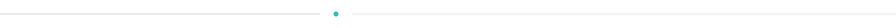
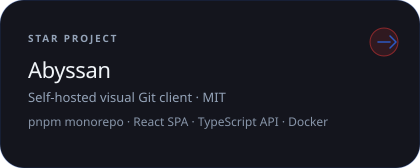
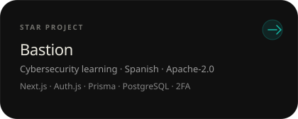
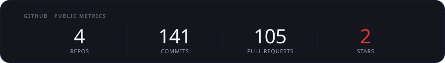

<picture>
  <source media="(prefers-color-scheme: dark)" srcset="assets/readme/hero.svg">
  <source media="(prefers-color-scheme: light)" srcset="assets/readme/hero-light.svg">
  
</picture>

I design and ship full-stack products—clear boundaries, relational data, automated delivery, and operable production environments.

  
  
  

<picture>
  <source media="(prefers-color-scheme: dark)" srcset="assets/readme/separator-dark.svg">
  <source media="(prefers-color-scheme: light)" srcset="assets/readme/separator-light.svg">
  
</picture>

### Featured work

<table>
  <tr>
    <td width="50%" valign="top">
      <a href="https://github.com/KevinBAG2001/Abyssan">
        <picture>
          <source media="(prefers-color-scheme: dark)" srcset="assets/readme/card-abyssan.svg">
          <source media="(prefers-color-scheme: light)" srcset="assets/readme/card-abyssan-light.svg">
          
        </picture>
      </a>
    </td>
    <td width="50%" valign="top">
      <a href="https://github.com/KevinBAG2001/bastion">
        <picture>
          <source media="(prefers-color-scheme: dark)" srcset="assets/readme/card-bastion.svg">
          <source media="(prefers-color-scheme: light)" srcset="assets/readme/card-bastion-light.svg">
          
        </picture>
      </a>
    </td>
  </tr>
</table>

Full project index → **[kevinbag2001.github.io](https://kevinbag2001.github.io/)**

<picture>
  <source media="(prefers-color-scheme: dark)" srcset="assets/readme/separator-dark.svg">
  <source media="(prefers-color-scheme: light)" srcset="assets/readme/separator-light.svg">
  
</picture>

### Professional work

Selected production systems (clients and employers anonymized).

| System | What it does | Stack |
| --- | --- | --- |
| **Correspondence & document platform** | Incoming/outgoing correspondence, approval flows, signed PDF closure, Alfresco-backed repositories, role-based access, operational PDF/Excel reporting | Laravel 11 · PHP 8.2 · PostgreSQL · Alfresco |
| **Personnel census** | Master employee records, org structure, and census workflows for large teams | Laravel 12 · React 19 |
| **Personnel operations platform** | Daily ops capture, shifts, goals, training, incidents, and PDF productivity outputs | React 19 · TypeScript · Vite · FastAPI · Docker · PostgreSQL 16 |
| **Training platform** | Course delivery, progress tracking, and certification-style workflows | Laravel 13 · React 19 |

<picture>
  <source media="(prefers-color-scheme: dark)" srcset="assets/readme/separator-dark.svg">
  <source media="(prefers-color-scheme: light)" srcset="assets/readme/separator-light.svg">
  
</picture>

### Core stack

React · TypeScript · Vite · Tailwind · PHP · Laravel · Python · FastAPI · Node.js · PostgreSQL · SQL Server · Prisma · Git · GitLab · CI/CD · Docker

Also working with .NET/C#, analytics, and applied AI in formal training.

<picture>
  <source media="(prefers-color-scheme: dark)" srcset="assets/readme/separator-dark.svg">
  <source media="(prefers-color-scheme: light)" srcset="assets/readme/separator-light.svg">
  
</picture>

### GitHub activity

<!-- STATS:START -->

Public metrics from the GitHub API (public repositories only). GitLab activity lives on [my GitLab profile](https://gitlab.com/KevinBAG2001).

<picture>
  <source media="(prefers-color-scheme: dark)" srcset="assets/readme/stats-dark.svg">
  <source media="(prefers-color-scheme: light)" srcset="assets/readme/stats-light.svg">
  
</picture>

Last updated: 2026-11-22 (UTC) · YTD counts for commits & PRs · <a href="https://github.com/KevinBAG2001/KevinBAG2001/actions/workflows/readme-stats.yml">readme-stats workflow</a>

<!-- STATS:END -->

<picture>
  <source media="(prefers-color-scheme: dark)" srcset="assets/readme/separator-dark.svg">
  <source media="(prefers-color-scheme: light)" srcset="assets/readme/separator-light.svg">
  
</picture>

### Now

- Master's in **Business Analytics & Intelligence** — in progress
- **Microsoft AI Specialization (150 h)** — completed Jan–Jul 2026

### Contact

**Email:** [kevinbryan_austria@outlook.com](mailto:kevinbryan_austria@outlook.com)

<strong>Perfil en español</strong>

 

Soy **desarrollador full-stack**: ingeniería de software, DevOps y datos. Construyo productos reales desde la idea hasta producción.

**Proyectos destacados:** [Abyssan](https://github.com/KevinBAG2001/Abyssan) (cliente Git visual autoalojable) y [Bastion](https://github.com/KevinBAG2001/bastion) (ciberseguridad para principiantes, en español). Portafolio: [kevinbag2001.github.io](https://kevinbag2001.github.io/).

**Experiencia profesional** (anonimizada en la tabla superior): plataformas de correspondencia/documentos, censo de personal, operación de personal y capacitación.

**Idiomas:** español nativo · inglés básico.

**Formación actual:** maestría en Analítica e Inteligencia de Negocios; especialización Microsoft en IA (150 h, 2026).

**Contacto:** [kevinbryan_austria@outlook.com](mailto:kevinbryan_austria@outlook.com) · [Portfolio](https://kevinbag2001.github.io/) · [GitLab](https://gitlab.com/KevinBAG2001) · [LinkedIn](https://www.linkedin.com/in/kevin-austria-galvan-605117274)

