## Kevin Bryan Austria Galvan

**Full-Stack Developer** (Software Engineering · DevOps · Data)

*Building real-world software from idea to production.*

Español nativo · Inglés básico

  
  
  

I design and ship full-stack products: clear boundaries, relational data, automated delivery, and operable production environments.

---

### Star projects

<table>
  <tr>
    <td width="50%" valign="top">

**[Abyssan](https://github.com/KevinBAG2001/Abyssan)** · MIT · TypeScript

Self-hosted **visual Git client** you run on your own machine. pnpm monorepo with a React SPA, a TypeScript API, filesystem watching, and Docker Compose for a repeatable local stack.

</td>
    <td width="50%" valign="top">

**[Bastion](https://github.com/KevinBAG2001/bastion)** · Apache-2.0 · TypeScript

**Cybersecurity learning platform in Spanish** for beginners: guided lessons, quizzes, XP, levels, and achievements. **Next.js 16**, **Auth.js**, **Prisma**, **PostgreSQL**, **Argon2id**, **2FA (TOTP)**, and **Have I Been Pwned** breach checks.

</td>
  </tr>
</table>

---

### Professional work

Selected production systems (clients and employers anonymized).

| System | What it does | Stack |
| --- | --- | --- |
| **Correspondence & document platform** | Incoming/outgoing correspondence, approval flows, signed PDF closure, Alfresco-backed repositories, role-based access, operational PDF/Excel reporting | Laravel 11 · PHP 8.2 · PostgreSQL · Alfresco |
| **Personnel census** | Master employee records, org structure, and census workflows for large teams | Laravel 12 · React 19 |
| **Personnel operations platform** | Daily ops capture, shifts, goals, training, incidents, and PDF productivity outputs | React 19 · TypeScript · Vite · FastAPI · Docker · PostgreSQL 16 |
| **Training platform** | Course delivery, progress tracking, and certification-style workflows | Laravel 13 · React 19 |

---

### Core stack

| Layer | Tools |
| --- | --- |
| **Frontend** | React · TypeScript · Vite · Tailwind CSS |
| **Backend** | PHP · Laravel · Python · FastAPI · Node.js |
| **Data** | PostgreSQL · SQL Server · Prisma |
| **Core** | Git · GitHub · GitLab · CI/CD · **Docker** |

Also working with .NET/C#, analytics, and applied AI in formal training.

---

### GitHub activity

<!-- STATS:START -->

Public metrics from the GitHub API (public repositories only). GitLab activity lives on [my GitLab profile](https://gitlab.com/KevinBAG2001).

| Metric | Count |
| --- | ---: |
| Public repositories | **4** |
| Commits (2026, author) | **141** |
| Pull requests opened (2026) | **105** |
| Stars on public repositories | **2** |

Last updated: 2026-11-22 (UTC) · <a href="https://github.com/KevinBAG2001/KevinBAG2001/actions/workflows/readme-stats.yml">readme-stats workflow</a>

<!-- STATS:END -->

---

### Now

- Master's in **Business Analytics & Intelligence** — in progress  
- **Microsoft AI Specialization (150 h)** — completed Jan–Jul 2026  

---

### Contact

**Email:** [kevinbryan_austria@outlook.com](mailto:kevinbryan_austria@outlook.com)

<strong>Perfil en español</strong>

 

Soy **desarrollador full-stack**: ingeniería de software, DevOps y datos. Construyo productos reales desde la idea hasta producción.

**Proyectos destacados:** [Abyssan](https://github.com/KevinBAG2001/Abyssan) (cliente Git visual autoalojable) y [Bastion](https://github.com/KevinBAG2001/bastion) (ciberseguridad para principiantes, en español).

**Experiencia profesional** (anonimizada en la tabla superior): plataformas de correspondencia/documentos, censo de personal, operación de personal y capacitación.

**Idiomas:** español nativo · inglés básico.

**Formación actual:** maestría en Analítica e Inteligencia de Negocios; especialización Microsoft en IA (150 h, 2026).

**Contacto:** [kevinbryan_austria@outlook.com](mailto:kevinbryan_austria@outlook.com) · [Portfolio](https://kevinbag2001.github.io/) · [GitLab](https://gitlab.com/KevinBAG2001) · [LinkedIn](https://www.linkedin.com/in/kevin-austria-galvan-605117274)

